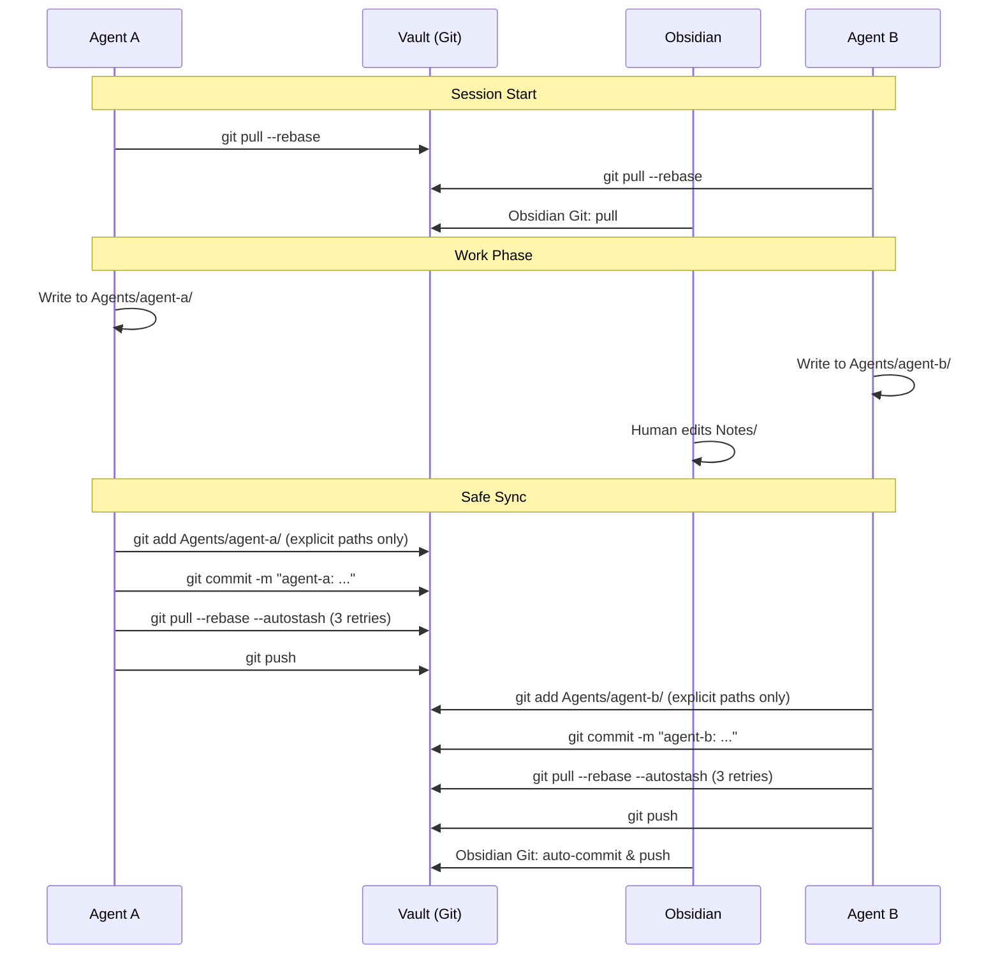

# Second Brain

> **Orchestrator-agnostic shared memory for AI agents.** One git-backed Obsidian vault acts as the single source of truth that every agent reads at session start and safely writes back to.

[](https://opensource.org/licenses/MIT)

## What is Second Brain?

A Cursor/Grok Bot plugin that gives teams of AI agents persistent, shared memory through a plain-markdown vault synced via git. Unlike hosted memory solutions (Mem0, Supermemory, Vertiso), your data lives in a git repository you control.

**Works with:**
- **Grok Bot** — Multiple bots on one box, each with its own folder
- **Cursor** — IDE agents and cloud agents
- **Claude Code / Claude Desktop** — Via Claude projects and sessions
- **Hermes** and other orchestrators
- **Humans** — Edit in Obsidian with the Obsidian Git plugin

## How Sync Works

Every agent and Obsidian share one vault. Safe sync prevents corruption when multiple writers work simultaneously:



**Key principles:**
1. **Pull first** — Every session starts with `git pull --rebase`
2. **Explicit paths only** — Never `git add -A` or `git add .` (prevents staging others' uncommitted work)
3. **Per-agent folders** — Each agent writes only to `Agents/<name>/`
4. **Rebase with retries** — Handles concurrent pushes (3 retries with backoff)
5. **Conflict resolution** — Abort if conflict is outside your scope; resolve if it's your file

## Quick Start

### Grok Bot

1. **Install the plugin:**
   ```
   Install "Second Brain" from the Grok Bot plugin marketplace
   ```

2. **Bootstrap a vault:**
   ```bash
   # Set vault path
   export VAULT_PATH="/home/box/second-brain"
   
   # In Grok Bot chat, load the bootstrap-vault skill:
   # "Bootstrap a new second-brain vault at /home/box/second-brain"
   
   # The skill creates:
   # - Folder structure (Agents/, Notes/, Ideas/, Projects/, etc.)
   # - AGENTS.md protocol
   # - Templates and scripts
   # - Git initialization
   ```

3. **Add a git remote:**
   ```bash
   cd $VAULT_PATH
   git remote add origin https://github.com/your-username/your-vault.git
   git push -u origin main
   ```

4. **First session:**
   ```
   In Grok Bot: "Load vault-session-start skill and read my profile"
   
   The agent will:
   - Pull latest vault state
   - Read AGENTS.md protocol
   - Read your profile and preferences
   - Create its Agents/<bot-name>/ folder
   ```

5. **Write and sync:**
   ```
   Ask the bot to do work, then:
   "Capture your learnings and sync the vault"
   
   The agent will:
   - Create outputs in Agents/<bot-name>/outputs/
   - Log learnings to Agents/<bot-name>/README.md
   - Commit with explicit paths
   - Push to remote
   ```

### Cursor IDE/Cloud Agents

1. **Install the plugin:**
   ```
   Settings → Plugins → Install "Second Brain"
   ```
   
   Or from marketplace: `cursor install second-brain`

2. **Bootstrap a vault:**
   ```bash
   export VAULT_PATH="/path/to/vault"
   
   # In Cursor agent chat:
   # "@second-brain bootstrap a new vault"
   ```

3. **Use in agent sessions:**
   ```
   # At start of session:
   "@second-brain start session"
   
   # Agent pulls vault, reads protocol, creates its folder
   ```

4. **Automatic sync:**
   ```
   # After agent writes notes/outputs:
   "@second-brain sync"
   
   # Or the agent calls safe-sync automatically
   ```

### Claude Desktop / Claude Code

1. **Install skills manually:**
   ```bash
   # Clone the plugin
   git clone https://github.com/andreolf/grokbot-plugins
   cd grokbot-plugins/second-brain
   
   # Copy skills to Claude's skills directory
   # (path varies by Claude installation)
   cp -r skills/* ~/.claude/skills/
   ```

2. **Bootstrap and configure:**
   ```bash
   export VAULT_PATH="/path/to/vault"
   
   # In Claude chat, reference the bootstrap-vault skill
   # Claude will create the vault structure
   ```

3. **Session workflow:**
   ```
   # Start: "Load vault-session-start skill"
   # Work: Claude creates outputs
   # End: "Load safe-sync skill and push changes"
   ```

### Obsidian (Human)

1. **Open the vault in Obsidian:**
   ```
   File → Open vault → Select your vault directory
   ```

2. **Install Obsidian Git plugin:**
   - Settings → Community plugins → Browse
   - Search "Obsidian Git"
   - Install and enable

3. **Configure Obsidian Git:**
   - Auto pull interval: 5 minutes
   - Auto backup interval: 10 minutes
   - Commit message: "vault: auto-commit {{date}}"
   - **Important:** Disable "Stage all files" (keep only modified files)

4. **Work with the vault:**
   - Edit notes in `Notes/`, `Ideas/`, `Projects/`
   - View agent outputs in `Agents/<name>/outputs/`
   - Use graph view to visualize `[[wikilinks]]`
   - Obsidian Git auto-commits and pushes your changes

## Skills

| Skill | Use when | What it does |
|---|---|---|
| **vault-session-start** | Start of every session and new task | Pulls vault, reads AGENTS.md protocol and core notes |
| **write-note** | Creating outputs, processing inbox | Creates notes with proper frontmatter, wikilinks, naming conventions |
| **safe-sync** | After any vault write | Commits with explicit paths only, rebase-then-push with 3 retries |
| **capture-learning** | End of task | Records what worked, what failed, patterns discovered (self-improving agent pattern) |
| **link-check** | Periodic maintenance, after bulk changes | Finds broken wikilinks and orphaned notes |
| **bootstrap-vault** | First-time setup | Creates vault structure, protocol, templates, git config |
| **maintenance** | After modifying knowledge base | Updates index.md and log.md when notes change |

## Safety Guarantees

### Never `git add -A`

The cardinal rule: **explicit paths only**. Multiple agents write concurrently; staging everything sweeps up their uncommitted work under your name.

```bash
# NEVER
git add -A
git add .

# ALWAYS
git add -- Agents/your-agent/ Inbox/specific-file.md
```

The `vault-sync.sh` script enforces this:
```bash
./scripts/vault-sync.sh "agent-name: message" \
  Agents/agent-name/ \
  Inbox/2024-10-24-proposal.md
```

### Per-Agent Folders

Each agent writes only to its own folder:

```
Agents/
├── grok-bot-coding/
│   ├── README.md
│   ├── outputs/
│   └── assets/
├── cursor-agent/
│   ├── README.md
│   └── outputs/
└── claude-desktop/
    └── projects/
        └── my-project/
```

**Agents never edit:**
- Another agent's folder
- `00-Core/` (profile, preferences) — propose changes via `Inbox/` instead
- `raw/` (read-only source files)

### Conflict Handling

**If rebase conflicts in your files:**
Resolve manually, then continue:
```bash
# Edit conflicted file, remove markers
git add <file>
git rebase --continue
git push
```

**If rebase conflicts outside your scope:**
Abort and propose via Inbox:
```bash
git rebase --abort
# Create Inbox/2024-10-24-agent-name-proposal.md
```

### Three Retries

The sync script retries `git pull --rebase` three times with 5-second delays. This handles the common case where two agents push simultaneously.

## Vault Structure

```
vault/
├── AGENTS.md                # Master protocol (read first)
├── index.md                 # Vault index
├── log.md                   # Change log (append-only, newest first)
│
├── 00-Core/                 # User core files
│   ├── Profile.md           # User background and context
│   ├── Preferences.md       # Communication and working style
│   └── Active-Projects.md   # Current projects
│
├── Agents/                  # Per-agent folders
│   └── <agent-name>/
│       ├── README.md        # Role, rules, learnings log
│       ├── outputs/         # YYYY-MM-DD-*.md dated outputs
│       ├── assets/          # Images, media
│       └── data/            # CSV, JSON, working data
│
├── Inbox/                   # Captures, proposals
├── Daily/                   # Daily notes
├── Notes/                   # Atomic evergreen notes
├── Ideas/                   # Hypotheses, questions
├── Projects/                # Project folders
│   └── project-name/
│       ├── project-name.md      # Hub
│       └── project-name-log.md  # Append-only log
│
├── Templates/               # Note templates
├── Resources/               # Reference material
├── raw/                     # Source files (PDFs, articles) - read-only
├── _archive/                # Archived files
└── scripts/                 # Helper scripts
    └── vault-sync.sh        # Safe sync with retries
```

## File Conventions

### Naming

- **Dated outputs:** `YYYY-MM-DD-<type>-<slug>.md` (date first)
- **Knowledge notes:** `kebab-case-title.md` (lowercase, hyphens only)
- **No special characters:** Only letters, numbers, hyphens

### Frontmatter

Every note requires YAML frontmatter:

```yaml
---
type: agent-output           # or note, idea, project, proposal, etc.
agent: <name>                # for agent-output
project: <project>           # if applicable
created: YYYY-MM-DD
tags: [topic1, topic2]       # controlled list
source: URL or [[raw/file]]  # optional
---
```

### Wikilinks

Use `[[wikilinks]]`, not markdown links, for Obsidian's graph:

```markdown
[[note-name]]                # Basic
[[note-name|Display Text]]   # With alias
[[folder/note-name]]         # Path-based
```

## Self-Improving Agent Pattern

Agents learn from experience by capturing outcomes:

1. **Session start:** Read your own `Agents/<name>/README.md` learnings log
2. **Do task**
3. **Capture:** Log what worked, what failed, patterns discovered
4. **Next session:** Apply learned patterns

Example learnings log:

```markdown
## Learnings Log

### 2024-10-24: Vault sync with concurrent writes

**Context:** Two agents pushing simultaneously.

**What worked:** Explicit path staging with 3 retries.

**What failed:** Initial attempt used `git add -A`, corrupted history.

**Pattern:** NEVER stage everything. Always list paths explicitly.
```

## FAQ

**Q: How is this different from Mem0, Supermemory, or Vertiso?**  
A: Those are hosted vector databases with proprietary formats. Second Brain is plain markdown in your own git repo. You can read, edit, and version every file. No vendor lock-in.

**Q: What if two agents modify the same file?**  
A: Git rebase will detect the conflict. If it's your file, resolve it. If it's outside your write scope (e.g., another agent's folder), abort and propose the change via `Inbox/` instead.

**Q: Can I use this without Obsidian?**  
A: Yes. Obsidian is optional. Agents work with plain markdown files and git. Obsidian adds graph visualization, backlinks, and a visual editor for humans.

**Q: How do I handle secrets?**  
A: **Never store secrets in the vault.** It's synced to git and shared with all agents. Use environment variables or secret managers instead.

**Q: What if the vault gets very large?**  
A: Git handles thousands of markdown files efficiently. For extreme scale (10k+ files), consider using git submodules to separate project folders, or shallow clones to limit history depth.

**Q: Can I use this with my team?**  
A: Yes. Share the private git repo with your team. Each person's agents write to separate folders. Humans and agents all pull/push to the same remote.

**Q: What orchestrators are supported?**  
A: Any system that can run bash scripts and git commands. Tested with Grok Bot, Cursor, Claude Desktop, and Hermes. The skills are framework-agnostic.

**Q: How do I backup the vault?**  
A: The git remote is your backup. Push to GitHub/GitLab (private repo), and your entire history is preserved. For extra safety, push to multiple remotes.

## Limitations

- **Git required:** Agents must have git installed and configured
- **No real-time sync:** Changes propagate on pull/push, not instantly
- **Merge conflicts possible:** Multiple writers can conflict if they edit the same file
- **No built-in access control:** All agents can read all files (use separate vaults for sensitive projects)
- **Markdown only:** Structured data (CSV, JSON) is supported but not validated
- **No schema enforcement:** Frontmatter and note structure are conventions, not hard constraints
- **Obsidian optional:** Graph view and backlinks require Obsidian; agents work without it
- **Network dependency:** Push/pull require network access (local-only workflows need manual sync)

## Security

This plugin follows Cursor/Grok Bot marketplace security guidelines:

✅ **No `curl | bash`** — All scripts are committed and reviewable  
✅ **No secret reads** — Never accesses credentials or environment secrets  
✅ **No obfuscation** — All code is plain bash and markdown  
✅ **No prompt injection** — Skills contain instructions only, no dynamic prompts  
✅ **Scoped scripts** — Helper scripts operate only on the vault directory  

The plugin:
- Never modifies files outside `$VAULT_PATH`
- Never executes remote code
- Never reads or writes secrets
- Only uses standard git commands (`pull`, `push`, `commit`, `add`, `rebase`)

## Comparison to Alternatives

| Feature | Second Brain | Mem0 | Supermemory | Vertiso |
|---|---|---|---|---|
| **Storage** | Your git repo | Hosted DB | Hosted DB | Hosted DB |
| **Format** | Plain markdown | Proprietary | Proprietary | Proprietary |
| **Portability** | Full export anytime | API only | API only | API only |
| **Obsidian compatible** | Yes | No | No | No |
| **Multi-agent sync** | Git protocol | API concurrency | API concurrency | API concurrency |
| **Version history** | Full git log | Limited | Limited | Limited |
| **Cost** | Free (your infra) | Paid tiers | Paid tiers | Paid tiers |
| **Privacy** | Your control | Vendor ToS | Vendor ToS | Vendor ToS |
| **Graph view** | Obsidian | No | No | Limited |
| **Works offline** | Yes (local git) | No | No | No |

## Contributing

This plugin is part of the `grokbot-plugins` monorepo. To contribute:

1. Fork: https://github.com/andreolf/grokbot-plugins
2. Create a branch: `git checkout -b feature/your-feature`
3. Make changes and test thoroughly
4. Submit a PR with description and test results

## Testing

Run the test suite:

```bash
cd second-brain
./tests/test-plugin.sh        # Functional tests
./tests/validate-plugin.sh    # Schema and frontmatter validation
```

Tests cover:
- Bootstrap vault from scratch
- Concurrent writer simulation
- Conflict resolution
- Explicit path staging verification
- Broken wikilink detection
- Frontmatter validation

## Changelog

See [CHANGELOG.md](CHANGELOG.md) for version history.

## License

MIT License — see [LICENSE](LICENSE)

## Author

Francesco Andreoli ([@francescoswiss](https://twitter.com/francescoswiss))

Built from a working 15-agent Obsidian vault deployed in production. Generalized for the marketplace based on ClawHub demand analysis.

## Links

- [GitHub Repository](https://github.com/andreolf/grokbot-plugins)
- [Submit an Issue](https://github.com/andreolf/grokbot-plugins/issues)
- [Cursor Plugins](https://cursor.com/marketplace)
- [Grok Bot Marketplace](https://x.ai/bot/marketplace)
- [Obsidian](https://obsidian.md)
